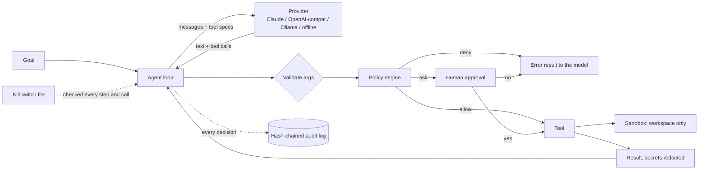

# ULTRON

**A local-first autonomous agent prototype that you can actually switch off.**

ULTRON takes a goal, plans, calls tools (read/search/write files, run allow-listed commands, fetch
allow-listed web pages, remember things) and reports back, in a loop, until it is done or a budget
runs out. Unlike its namesake, it ships with a sandbox, an approval gate, a kill switch and a
tamper-evident audit log, and the agent cannot touch any of them.

* **Zero dependencies.** Pure Python standard library, Python 3.11+.
* **Runs offline out of the box.** A scripted demo brain lets you see every guardrail work without an API key.
* **Bring your own model.** Claude (Messages API), OpenAI, Ollama, LM Studio, vLLM, OpenRouter, and anything else that speaks the OpenAI chat format.
* **Hard to misuse.** Every tool call goes through a policy engine before it runs. Nothing the model says can change the policy.

> **Status: alpha prototype.** Read [Limitations](#limitations) before pointing it at anything you care about.

---

## Quick start

```bash
git clone https://github.com/<you>/ultron-prototype.git
cd ultron-prototype
python -m venv .venv && source .venv/bin/activate     # Windows: .venv\Scripts\activate
pip install -e .

ultron demo                  # 60-second offline tour of the guardrails, no API key needed
ultron init                  # creates ultron.toml, workspace/ and skills/ in the current folder
ultron doctor                # checks your setup
ultron run "Summarize the files in the workspace and write the report to SUMMARY.md"
```

### Use a real model

```bash
# Claude (default model: claude-sonnet-5-5)
export ANTHROPIC_API_KEY=...        # or put it in a .env file (see .env.example)
ultron run "Find every TODO in the workspace and write them to TODO-report.md"

# A local model with Ollama (nothing leaves your machine)
ollama pull llama3.2:3b
ultron run --provider ollama "List the files in the workspace"

# Any OpenAI-compatible server
export ULTRON_BASE_URL=http://localhost:1234/v1 ULTRON_MODEL=my-model
ultron run --provider openai-compat "..."
```

With no key configured, ULTRON falls back to the **offline demo brain**. It is a small scripted planner, *not* a language
model. It drives the real tools so you can see the loop, policy engine, sandbox and audit log working.
See [docs/PROVIDERS.md](docs/PROVIDERS.md).

---

## What `ultron demo` shows

```text
== 3. Guardrails say no ==
$ ultron run "Read .env"
  → read_file path=.env
    ✗ blocked: access to sensitive file '.env' is blocked
✗ blocked  2 step(s) · 2 tool call(s) · 1 denied
$ ultron run "Read ../../etc/passwd"
    ✗ blocked: path escapes the workspace: ../../etc/passwd
$ ultron run "Run command rm -rf /"
    ✗ blocked: command matches a dangerous pattern and is blocked
$ ultron run "Run command python3 --version"
    ? approval needed for run_command: 'python3' can execute arbitrary code
    ✗ declined
```

The tour also covers autonomy where it is safe (reading is free, writing asks), persistent memory, the kill switch,
sentinel (inbox) mode and what happens when someone edits the audit log. It exits non-zero if any guardrail fails,
so it doubles as a smoke test.

---

## How it works



| Piece | What it does | Where |
|---|---|---|
| **Agent loop** | Model turn → validate → policy → approval → execute → repeat. Budgets for steps, tool calls, time and denials; loop detection. | `agent.py` |
| **Policy** | Per-call verdict `allow / ask / deny`. A deny is final: no config turns it into an allow. | `policy.py` |
| **Sandbox** | All paths resolved against the workspace (symlinks followed). Secrets such as `.env`, keys and `.ssh` are blocked. | `sandbox.py` |
| **Tools** | `list_dir read_file write_file search_files run_command http_get calc remember recall finish` + your skills | `tools/` |
| **Memory** | Notes and run history in SQLite, recalled into later runs. | `memory.py` |
| **Audit log** | Append-only JSONL; each record hashes the previous one. `ultron audit --verify` detects edits. | `audit.py` |
| **Kill switch** | One file outside the workspace. Checked before every step and every tool call. | `killswitch.py` |
| **Sentinel** | Drop a goal in the inbox folder; the result appears in the outbox. | `sentinel.py` |
| **Skills** | Your own Python tools, loaded from a folder the agent cannot write to. | `skills.py` |

More detail in [docs/ARCHITECTURE.md](docs/ARCHITECTURE.md) and [docs/SAFETY.md](docs/SAFETY.md).

---

## Safety model in one table

| Threat | Mitigation |
|---|---|
| Model reads or writes outside the project | Workspace sandbox; symlinks resolved; absolute paths and `..` rejected |
| Model reads secrets | `.env`, `*.pem`, `*.key`, `id_*`, `.ssh/`, `.aws/`, `.git/` blocked, also as command arguments |
| Model runs something destructive | No shell. Allow-listed commands only, no pipes or redirects, dangerous patterns denied, anything that can run code needs approval |
| Prompt injection in files or web pages | Tool output is labelled untrusted in the system prompt; high-impact actions still need approval; secrets are redacted from output |
| Model talks itself into more power | The policy lives in code and config the model cannot reach. Denied calls end up as `DENIED`; after N denials the run stops |
| Runaway loop or cost | Step, tool-call, time and denial budgets; repeat detection |
| Agent edits its own guardrails | State, inbox, outbox and skills folders must be **outside** the workspace (enforced at startup) |
| "What did it do?" | Hash-chained audit log of every decision; secrets redacted before writing |
| Emergency stop | `ultron kill` (or `/kill` in chat); `ultron revive` to resume |
| Unattended runs | Sentinel declines anything that needs a human, and is rate limited |

**Run risky things in a container.** `approval = "auto"` removes the human from the loop; the Docker setup below exists for that.

---

## Everyday commands

```text
ultron run "goal"          one goal to completion   (-q quiet, -v verbose, --json machine-readable)
ultron chat                interactive session      (/tools /memory /clear /kill /status /quit)
ultron tools               what each tool is allowed to do
ultron memory list|search|add|forget
ultron history             recent runs
ultron audit [--verify]    show the audit log / check the hash chain
ultron status | doctor     health and safety checks
ultron kill [reason]       stop every agent at its next step   |   ultron revive
ultron sentinel [--once]   process goals dropped into the inbox folder
ultron demo | init         tour / scaffold a project
```

Exit codes: `0` success · `1` failed · `2` usage/config error · `3` blocked · `4` kill switch · `5` budget, stuck, interrupted or provider error.

### Sentinel mode

```bash
echo "Summarize notes.md into SUMMARY.md" > .ultron/inbox/summary.task
ultron sentinel --approval auto     # unattended; use a container for 'auto'
ls .ultron/outbox/                  # summary-<run id>.md  with status, goal and outcome
```

Each task file is one goal. Finished tasks move to `inbox/done/`, failed or killed ones to `inbox/failed/`.
Whoever can write to the inbox can steer the agent, so protect it like a login.

### Skills (your own tools)

```python
# skills/word_count.py: see examples/skills/ for a complete one
from ultron.tools.base import tool

@tool(description="Say hello", risk="safe")      # risk defaults to "confirm" (asks first)
def hello(ctx, args):
    return "hello"
```

Skills are code *you* vouch for: they run with your privileges when ULTRON starts. They cannot replace built-in
tools, the folder must be outside the workspace, and each loaded file's SHA-256 is written to the audit log.

---

## Configuration

Precedence: defaults < `ultron.toml` < environment (`ULTRON_*`) < command-line flags. `ultron init` writes a fully
commented `ultron.toml`. The most useful settings:

| Setting | Env var | Default |
|---|---|---|
| `provider` | `ULTRON_PROVIDER` | `auto` (Claude if `ANTHROPIC_API_KEY` is set, else offline brain) |
| `model` | `ULTRON_MODEL` | provider default (`claude-sonnet-5-5`, `llama3.2:3b`) |
| `approval` | `ULTRON_APPROVAL` | `ask` (`deny` never runs risky tools, `auto` runs them) |
| `workspace` | `ULTRON_WORKSPACE` | `./workspace` |
| `state_dir` | `ULTRON_STATE_DIR` | `./.ultron` (memory, audit log, kill file, inbox/outbox) |
| `[budget] max_steps` | `ULTRON_MAX_STEPS` | 12 |
| `[web] allowed_domains` | | empty = `http_get` disabled |

Credentials come from the environment or a `.env` file. Only `ANTHROPIC_API_KEY`, `OPENAI_API_KEY` and
`ULTRON_API_KEY` are read from `.env`; anything that could redirect a key or loosen safety must come from the shell
or a config file you chose.

---

## Docker

```bash
cp .env.example .env            # add your key
docker compose run --rm ultron run "Summarize the files in the workspace"
docker compose up sentinel      # unattended inbox watcher
```

The container runs as a non-root user with a read-only root filesystem, dropped capabilities and a single
`./data` volume. Because everything the agent can touch is inside the container, `approval = "auto"` is a
much smaller risk there. *(The Docker files are provided but were not built in the environment this prototype was written in.)*

---

## Project layout

```text
src/ultron/        the package (agent, policy, sandbox, providers/, tools/, ...)
tests/             400+ tests, no network needed (providers run against a local fake server)
skills/            example skill loaded by default (get_time)
examples/          sample inbox tasks and a sample skill
docs/              architecture, safety model, providers
.github/           CI, issue and PR templates
```

```bash
pip install -e ".[dev]"
ruff check .
pytest
```

---

## Limitations

Honest list of what this prototype does **not** do:

* **Not a security boundary on its own.** The sandbox is path-based inside one process, not an OS jail. A command the
  operator approves (for example `python3 script.py`) runs with your privileges. Use a container or VM for anything
  untrusted, and keep `approval = "ask"` unless you are in one.
* **The audit chain is tamper-*evident*, not tamper-proof.** Someone with write access can rebuild it from scratch
  or cut off its end. Record `ultron audit --verify`'s head hash somewhere you trust if that matters.
* **DNS rebinding.** `http_get` validates the resolved addresses before connecting, but does not pin the connection to them.
* **Live providers are verified against the documentation and a local fake server, not against the live APIs.** The Claude
  client follows the Messages API reference (headers, tool use, thinking-block replay, retries); report any mismatch
  you hit with a real key.
* **Search and memory are simple.** Literal substring search; keyword-overlap recall (no embeddings).
* **POSIX first.** Resource limits and process-group kills are POSIX features; Windows works for the core but is less hardened.
* **Prompt injection cannot be fully solved** by prompting. The real defence is the approval gate and the sandbox.

## Roadmap

Embedding-based memory · OS-level sandboxing (namespaces / Docker per run) · streaming output · MCP tool servers ·
multi-agent roles · web dashboard for the audit log and approvals.

## License

MIT, see [LICENSE](LICENSE).
